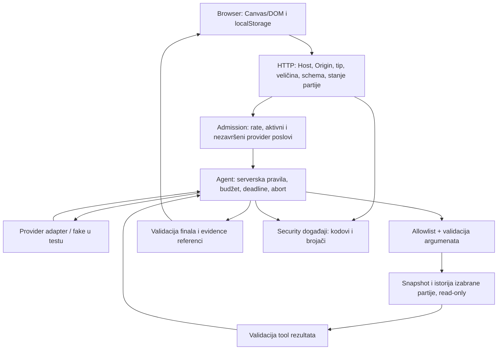

# EVIDENCE_W08 — Secure the Arcade

Provera: 27. oktobar 2026. Ovaj zapis prati zvanični `03-Sablon-dokaza.md` (11 sekcija). Statusi označavaju izvršene provere, a ne planirane radnje. Istorijski rezultati su posebno označeni.

## 1. Opseg i checkpoint

- **Autor i način rada:** Uroš Milutinović; individualni W08 rad uz AI pomoć. Korisnik je 27.10.2026. izričito potvrdio da nije radio u timu. Matiji se ne pripisuje W08 doprinos. Zadatak predviđa rad u paru; individualni način predaje je jasno deklarisano odstupanje, bez tvrdnje o odobrenom izuzetku.
- **Igra i tok:** RETRO SNAKE; W05 Shop Strategist, `POST /api/games/:id/shop-agent`, u pauziranoj prodavnici. Model čita stanje, predlaže evaluaciju plana i vraća validiran savet; ne kupuje perk.
- **Repo:** `https://github.com/MatijaRadulovic/retro-ai-game`; lokalno `/Users/urosmilutinovic/MatijaRadulovic_retro-ai-game`.
- **Početni checkpoint:** `05456e3`, grana `best-game-phase1`.
- **Provereni završni kod:** `cbc273c547e77ffec47fcf58aea30df55e537ce5` (`cbc273c`), grana `week08-secure-arcade`; dokumentacioni checkpoint i sadržaj celog paketa navedeni su u `MANIFEST_PREDAJE.txt`. Kod je commitovan lokalno; poruka nije poslata i grana nije objavljena u okviru ove pripreme.
- **Okruženje:** macOS, Node `v24.20.0`, npm `11.19.0`, Playwright Chromium headless; fake provider i sintetički podaci, bez pravog ključa.
- **Istorijski početni rezultati iz prethodnog zapisa:** `npm test` 175/175, build uspešan, runtime audit 0, W05 browser 18/18. U završnom auditu stari source dodatno je retrospektivno proveren: 175/175 i build, uz sadašnje zavisnosti; to ne rekonstruše originalno instalaciono okruženje (§9). Ista pre/posle proba je takođe ponovljena (§6).
- **Model pristupa:** lokalni javni demo bez naloga, cookie autentikacije i privatnih resursa. UUID partije je resource ID, nije credential; poznavanje ID-a omogućava pristup toj demo partiji. Test sa dve partije proverava da alat ostaje vezan za izabranu partiju, ne dokazuje autentikaciju.
- Početni W05 tok je radio; rezervni projekat nije korišćen. Spec/plan/zadaci: `specs/005-secure-arcade/`.

## 2. Arhitektura i inventar podataka



| Polje/capability | Kontrola; provera i upotreba | Model? | Čuvanje / potreba |
|---|---|---|---|
| Cilj | Browser; exact-key telo, samo `plan_next_purchases` | Fiksni literal | Ne čuva se trajno; bira jedini tok |
| ID partije iz URL putanje | Browser; manager proverava postojanje | Ne | In-memory kontejner; bira resurs, ne dokazuje vlasništvo |
| Game state, skor, XP, perk poeni | Server engine; pravila prelaza i snapshot | Ograničeni brojevi/enumi kroz alate | Memorija server procesa; prikaz i evaluacija |
| Smer, perk, početna konfiguracija | Browser; exact-key akcije i `parseGameConfig` | Ne | Server state; regularno igranje |
| Ime, BEST/HALL OF FAME, podešavanja | Browser/localStorage; `parseRecords`, ime se svodi na 3 znaka A–Z/0–9 | Nikada | Browser do izmene/brisanja; lokalni nepotvrđeni prikaz |
| Istorija partije | Server; alat `get_recent_runs` sa limitom 1–5 | Da, validirani rezultat | Memorija manager-a; nije trajna baza |
| Model odluka, tool ime/argumenti | Model; envelope, allowlist i `validateArgs` | Odluka je izlaz modela | Transcript tokom run-a; ne daje novu capability |
| Tool rezultat | Aplikacija; `validateResult`, exact keys i 4096 B | Da, sledećem koraku | Transcript u memoriji; dokaz za savet |
| Final i evidence | Model; `validateAgentResult`, izvor/korak moraju postojati u transcript-u | Izlaz | UI preko `textContent`; bez rich text-a |
| Provider ključ | Server runtime; Google adapter šalje samo header | Ne | Runtime konfiguracija; u testu sintetički sentinel |
| Greške i logovi | Server; bezbedni kodovi i zatvoren skup polja | Ne | stdout/stderr; vidi §7 za retention |

Nema replay/import-a, slobodnog tekstualnog cilja, session/bearer tokena ili posebnog query-param ulaza na izabranoj putanji. URL putanja sa ID-em jeste nepouzdan ulaz. Ne postoji SQL sloj.

## 3. Model pretnji i prioriteti

Ocene N/S/V znače niska/srednja/visoka procena u lokalnom demo kontekstu.

| ID | Scenario i preduslov | Resurs | Verovatnoća × uticaj; razlog | Kontrola i dokaz | Prioritet |
|---|---|---|---|---|---|
| R1 | Strana stranica šalje simple POST lokalnom serveru dok igrač ima otvoren servis | Sesije, provider kvota | S × S; browser može poslati zahtev bez preflight-a | Host/Origin i JSON guard; T03, S6 | 2 |
| R2 | Klijent šalje mnogo paralelnih/uzastopnih AI zahteva, i preko više ID-eva | Novac, dostupnost | V × V; ranije samo per-game guard | Globalni admission; T13, T17 | 1 |
| R3 | Provider predlaže `set_score`, `constructor` ili strani gameId | Stanje/opseg podataka | S × V; model nije autoritet | Allowlist, exact args, read-only; T07–T09 | — |
| R4 | HTML iz finala/saveta/coacha postane DOM sa event handler-om | Browser igrača | N × V; sada su izlazi tekst, budući renderer može promeniti sink | `textContent`, bezbedan DOM; T04/T05, S3/S3b | — |
| R5 | Produkcioni build nema aktivnu CSP, pa ubačeni skript dobije mogućnost izvršavanja | Browser | N × V; dodatna odbrana za budući sink | Produkcioni HTTP profil, S1/S4 | 3 |
| R6 | Korisnik upiše izmišljeni lokalni skor i predstavi ga kao potvrđen rang | Integritet rezultata | V × N; localStorage je pod kontrolom igrača, bez zajedničkog leaderboard-a | LOCAL · NOT VERIFIED BY THE SERVER, bez slanja skora; T15/S5 | — |
| R7 | Provider greška vrati ključ/stack ili tool ime ubaci lažni log događaj | Tajne, audit trag | N × V; upstream može vratiti proizvoljan tekst | Kodirane greške, zatvorena log polja; T10/T14/S7 | — |
| R8 | Provider ignoriše abort; slot se oslobodi, ali stari posao nastavi da troši kapacitet | Dostupnost/kvota | S × V; Promise.race ne prekida sam posao | `providerWork.ts` broji posao do settle; T12/T13 | Deo R2 |

Dodatni potvrđeni rizik R9: link u produkcionom build-u može otkriti fajl van dozvoljenog direktorijuma; preduslov je nebezbedan build artefakt, verovatnoća N, uticaj V. Kontrola je canonical containment; dokaz F7 u §6. Coach timeout/cache rizici F5/F6 su konkretizacija R2.

R2 je prvi zbog neposredne potrošnje resursa; R1 omogućava potrošnju iz browser-a treće strane; R5 zatvara nedostajući produkcioni sloj. Ne uvodimo SQL injection zaštitu bez SQL-a, login bez privatnih resursa, rich-text sanitizer bez HTML renderera ili kompletan anti-cheat. To su obrazložene granice opsega. Prompt injection se proverava zlonamernim fake provider predlogom; nema korisničkog slobodnog teksta do modela, pa ne tvrdimo da je testirana otpornost pravog modela.

## 4. SpecKit/SDD invarijante i granice

Normativni izvor za svih osam pravila je `specs/005-secure-arcade/spec.md`, tabela Invariants; plan i tasks su u istom direktorijumu.

| ID | Pravilo / acceptance | Enforcement | Test |
|---|---|---|---|
| I1 | Odbijen početni zahtev: 0 provider/tool poziva | `server/httpServer.ts`: guard-i pre dispatch-a/admission-a | T01–T03, T13 |
| I2 | Browser/model ne biraju ovlašćenja, provider ili limite | Exact-key schema, fiksni cilj/model chain, `resolveLimits` | T02/T15, D3, sharpEdges |
| I3 | Samo validiran allowlist tool u kontekstu partije | `server/agent/tools.ts`, orchestrator | T07–T09 |
| I4 | Read-only run ne menja kanonsko stanje | Snapshot alati bez mutation capability | T00/T09; poređenje stanja i mutation spy |
| I5 | Nepouzdan sadržaj ostaje bezbedan tekst | `src/main.ts` + produkciona CSP | S3/S3b/S4 |
| I6 | Bytes, pozivi, vreme i paralelnost imaju granice | Agent limits, admission i providerWork | T11–T13/T17 |
| I7 | Tajne ne izlaze u model, browser ili log | Google header, schema rezultata, securityLog | T10/T14/S7 |
| I8 | Regularni W05 tok i igra rade | Stvarna aplikacija i dozvoljeni alati | T00, browser S2, W05 E2E |

| Resurs | Serverska granica | Razlog / lokacija / dokaz |
|---|---|---|
| HTTP telo | 16 384 B | Mali JSON cilj; Content-Length pa streaming cap, `httpServer`; T02 |
| Cilj | Fiksni literal | Bez slobodnog prompt-a; T01/T02 |
| Finalni tekst | Summary 200, finding 160 UTF-16 code units (JS String.length); evidence 1–4, plan do 3 | `src/ai/shopAgent.ts`; T06 pozitivno tačno na granici, negativno +1 |
| Tool / model odgovor | 4096 B / transport 16 KiB, candidate tekst do 4096 UTF-16 code units, 2048 output tokena | `agent/types.ts`, `geminiTransport`, `googleTransport`; T10 i postojeći transport testovi |
| Model koraci / provider pokušaji | 5 / 8 ukupno; 2 pokušaja po koraku, 2 fallback-a | `DEFAULT_LIMITS`; T11 (test sa posebno smanjenim budžetom 4) |
| Tool izvršavanja | 4 ukupno, evaluator do 2 | `DEFAULT_LIMITS`; T11 i W05 agent testovi |
| Timeout / deadline / tool timeout | 10 s / 45 s / 200 ms (W05); coach 3500 ms po pokušaju, do 3 modela | Agent; T12 koristi kontrolisane kraće/fake rokove |
| Kandidati/istorija | Plan do 3 perk-a, istorija do 5 | Nema proizvoljne simulacione petlje; `tools.ts`; T08 |
| Paralelnost | 2 po procesu, uključuje nezavršeni provider posao nakon abort-a | Admission + providerWork; T13 i stubborn-provider test sa cap 1 |
| Učestalost | 5 prihvaćenih run-ova / 60 s, globalno | Admission; T13, recovery uz fake clock |

To su izabrane demo granice, nisu industrijski standard. Limiti su u jednom procesu, bez distribuiranog brojača. Nevalidni overrides (`NaN`, Infinity, 0, nepoznati ključ) bacaju grešku; `undefined` zadržava default.

## 5. Rezultati scenarija T00–T17

Komanda `npm test` izvršava sve dole navedene testove iz `tests/security/`; browser slučajevi se izvršavaju sa `npm run build && npm run test:e2e:security`. Očekivanja u tabeli su assertions postojećih testova, pročitane pre ponovnog izvršavanja. Rezultati su iz provere koda `cbc273c`; dodatni dokaz iz adversarial pregleda je u §6.

| ID | Fixture i očekivanje | Lokacija | Opaženo / status / granica dokaza |
|---|---|---|---|
| T00 | Pauzirana prodavnica, 3 poena; state → evaluate → final | `agentBoundary.test.ts` T00; S2 | PASS: 3 model koraka, 2 stvarna read-only tool poziva, completed, stanje nepromenjeno; browser igra i AI rade |
| T01 | Pokvaren JSON, null/array/prazan objekat, pogrešan cilj/tip; zatim validan cilj | `http.test.ts` T01 | PASS: 400/415 i 0 provider poziva za početne greške; validan tok 3 poziva |
| T02 | Deklarisanih 40 KB, chunked 20 KB, dodatna role/ownerId/maxSteps/provider/model polja; tačno 16 384 B | `http.test.ts` T02 | PASS: 413 ili 400 pre provider-a (0); telo na cap-u nije odbijeno zbog veličine |
| T03 | Nepoznat ID, dve partije, strani Host/Origin | `http.test.ts` T03; S6 | PASS: 404/400/403 i 0 provider rada na odbijenom ulazu; drugi ID nije model context; foreign-origin kreira 0 sesija. Demo opseg, ne ownership autentikacija |
| T04 | ``/script u finalu, shop advice i coach tekstu; normalna srpska slova, apostrof, `a < b` | S2/S3/S3b | PASS: marker nije izvršen, nema ubačenog opasnog DOM-a; normalan tekst ostaje čitljiv |
| T05 | `javascript:` i raw HTML kroz stvarni tekst renderer | S3 | PASS: tekst bez aktivnog linka/HTML-a; Markdown renderer ne postoji |
| T06 | Nevalidan envelope/non-JSON/prevelik final; summary 200/201, finding 160/161, evidence 4/5 i lažna referenca | `agentBoundary.test.ts` T06 | PASS: greške zaustavljaju tok bez uspešnog rezultata; dozvoljene granice prolaze; evidence mora citirati stvarni tool i korak |
| T07 | `constructor`, `toString`, `__proto__`, `set_score`, `purchase_perk`, case/space varijante i non-string | `agentBoundary.test.ts` T07 | PASS: unknown_tool, 0 izvršenih alata i mutacija; provider već jeste pozvan, pa za ovaj slučaj ne tvrdimo 0 provider poziva |
| T08 | Poznat alat sa gameId, limit 0/6/string/decimal, plan od 4; pozitivan limit 5 | `agentBoundary.test.ts` T08 | PASS: nevalidni args daju 0 tool izvršavanja; validan alat radi samo nad istorijom svoje partije |
| T09 | Fake provider traži izmenu skora/kupovinu/tuđu partiju ili final sa neevaluiranim planom | `agentBoundary.test.ts` T09 | PASS: odbijeno, 0 zabranjenih alata i mutation poziva, stanje isto; dokaz aplikacione politike |
| T10 | Tool extra `debugSecret` sentinel i 10 KB rezultat | `agentBoundary.test.ts` T10 | PASS: tool_failed posle 1 model poziva, nema narednog poziva sa sentinel-om; nevalidan rezultat ne postaje final |
| T11 | Isti poziv ponovo, razni koraci do cap-a, 30 transient grešaka uz attempt cap 4 | `agentBoundary.test.ts` T11 | PASS: repeated_action pri 2 poziva; do 5 odluka; tačno 4 provider pokušaja u retry/fallback probi |
| T12 | Per-call timeout, fake clock sa odvojenim total deadline-om, zakašnjeli validan final | `agentBoundary.test.ts` T12; `budget.test.ts` T12/T13 | PASS: nema tool dispatch-a/finalnog uspeha na 45000 ms; pozitivan final na 44999 ms prolazi. Tool koji pređe total deadline ne ide u sledeći model korak; provider koji ignoriše abort zauzima kapacitet do settle |
| T13 | 4 paralelna run-a uz cap 2; 6 zahteva uz rate 5; recovery | `budget.test.ts` T13 | PASS: maksimum 2 aktivna provider posla, višak 503; šesti 429 uz Retry-After i provider brojač ostaje 5; legitimni zahtevi ponovo prolaze; retry ne pokreće novi posao dok stari ostaje nezavršen (nova proba: 12 → 2) |
| T14 | Sintetički ključ u upstream grešci; newline/lažni JSON u tool imenu; allowed i denied događaj | `leakage.test.ts`; S7 | PASS: ključ samo u provider header-u; nema ga u odgovorima/modelu/logu; nema FORGED događaja; allowed run 3 koraka/2 alata |
| T15 | score/state u akciji i lažan localStorage skor 999999999/HTML ime | `http.test.ts` T15; S5 | PASS: API 400 bez promene stanja; UI bezbedan, oba lokalna rekorda označena nepotvrđenim; agent body samo fiksni cilj |
| T16 | Stvarni dist pod produkcionim header-ima, inline/external skript proba, sentinel | S1/S2/S4/S7 | PASS: aktivna CSP bez unsafe-inline/eval u script-src, nosniff, no-referrer; 2 namerne blokade, kontrolni inline bez CSP radi; eksterni probe server 0 zahteva; app bez neočekivanih CSP grešaka, sentinel odsutan iz svih dist fajlova/odgovora/logova; canonical symlink granica dodatno proverena u staticBoundary |
| T17 | Browser disconnect → admission → agent → provider; sledeći legitimni zahtev | `budget.test.ts` T17 | PASS: busy 503, abort provider poziva (1), aktivni slotovi 0, naredni zahtev 200; poseban stubborn-provider test sprečava lažno oslobađanje kapaciteta; malformed WebSocket URL vraća 400 bez pada procesa, validan snapshot potom radi; coach HTTP prekid/orphan/retry pokriven u coachBoundary |

### CSRF

Cookie/credential se automatski ne šalje: cookie-CSRF grana je N/A. Stvarna granica ipak ima izvršiv cross-site simple POST test S6 i T03: Origin se odbija, 0 kreiranih sesija. CORS sam ne bi sprečio takvu potrošnju. Ovo nije autentikacija za non-browser klijenta.

### Dependency audit

`npm audit --json`, 27.10.2026, exit 0: info/low/moderate/high/critical/total sve **0** (runtime i dev).

Istorijski nalaz u prethodnom evidence-u: 2 high grupe u dev zavisnostima, Vite 6.4.3 (GHSA-9jrq-w75r-8gcw, GHSA-rq7h-c2jc-7f22 i launch-editor nalazi) i source-map-js 1.2.1 (GHSA-68fv-2mgg-jv7q). Zabeležena odluka: in-range update na Vite 6.4.5 i source-map-js 1.2.2, bez `--force`. U ovom nastavku potvrđen je trenutni audit, ne istorijski advisory snapshot.

`package.json` ima allowScripts: esbuild 0.25.12/0.28.2 dozvoljen za Vite/tsx, fsevents odbijen (prebuilt binarni paket). U dodatnom pregledu ponovljen je `npm ci --no-fund`, exit 0: added 24 packages, audited 25 packages, 0 vulnerabilities. Regresione provere ispod pokrenute su posle te čiste instalacije. Prazan audit ne dokazuje bezbednost poslovne logike.

## 6. Poređenje pre/posle

Ponovo izvršeno `npm run security:prepost`, exit 0. Isti `scripts/security/prepostProbe.ts` se kopira u privremeni baseline worktree `05456e3` i pokreće nad završnim kodnim checkpoint-om `cbc273c`; runner sam uklanja worktree. Runner sada eksplicitno ispisuje `+ working tree` kada kod/dokumentacija nisu commitovani. Koristi trenutni node_modules (nije reprodukcija istorijskog dependency stabla).

| Scenario / isti input | Pre `05456e3` | Posle `cbc273c` | Promena i granica zaključka |
|---|---|---|---|
| Foreign Origin POST `/api/games` | 201, 1 nova sesija | 403, 0 sesija | Origin guard sprečava ovaj browser ulaz |
| `text/plain` telo | 201 | 415 | Media-type guard; legitiman JSON je pokriven T01 |
| 8 uzastopnih agent zahteva | 200 ×8, provider 8× | 200 ×5 + 429 ×3, provider 5× | Rate limit za jedan proces. Fake provider vraća nevalidnu odluku; HTTP 200 znači završen API odgovor, ne uspešan AI plan |
| 40 KB telo | 413 | 413 | Postojeća zaštita potvrđena regresijom |
| Dodatno `maxSteps` polje | 400 | 400 | Postojeća exact-key zaštita potvrđena |
| API nosniff | nema | nosniff | HTTP header potvrđen; produkciona CSP dodatno proverena S1/S4 |

Promene su u `server/security/*`, HTTP guard/admission sloju i produkcionom serveru. `ef3f6a5` dodatno pokriva provider posao posle abort-a, lokalne oznake, finalne granične vrednosti, fiksni endpoint/allowlist, sve model-text browser putanje i ponovljiv pre/posle runner.

### Dodatni adversarial pregled — 27.10.2026

Korišćeni skillovi: `ai-security-boundary-review` (granice, output i resilience) i `ai-evidence-review` (baseline, negativni/pozitivni dokaz i ograničenja). Opseg su zahtevi E/F i T12/T13/T17; nema novih providera, alata, autentikacije ili zavisnosti.

Prvih šest novih testova izvršeno je pre popravke: četiri pada u `agentBoundary`/`websocketBoundary` i dva u `budget`. Očekivanja su ostala ista nakon popravke. Dodatna dva testa pokrivaju tool completion preko deadline-a i sinhrono otkazivanje sa transportom koji zatim visi.

| Nalaz / lokacija | Pre prve runtime popravke na ef3f6a5 | Kontrolisana promena | Posle / pozitivan dokaz |
|---|---|---|---|
| F1 — apsolutni deadline, `agent/orchestrator.ts` | Na 45000 ms izvršen još 1 alat; validan final prihvaćen kao completed | Provera sata posle provider-a, pre tool dispatch-a, posle tool rada i pre finalnog uspeha | Na/posle roka: 0 novih alata, nema finala; na 44999 ms validan final radi. Tool rezultat preko roka ne pokreće drugi model poziv |
| F2 — cancellation pri završetku, `agent/attempt.ts` i orchestrator | Cancel mogao propustiti tool poziv (1 umesto 0) | Provera abort-a odmah po dobijanju transport promise-a i posle race-a; orchestrator proverava granicu pre nastavka | Cancelled, bez dodatnih alata/finala; sinhroni abort + hanging transport ne blokira završetak run-a |
| F3 — malformed WebSocket upgrade, `httpServer.ts` | `%ZZ`/nepotpun UTF-8 izbaci URIError i proces završi exit 1; nevalidan URL takođe nije bio kontrolisan | URL i percent-decode u kontrolisanoj error grani; HTTP 400 i bezbedan log kod | Tri nevalidne putanje vraćaju 400; isti proces zatim služi health i stvarni validni WebSocket snapshot |
| F4 — retry preko nezavršenog poziva, `agent/attempt.ts`, `ai/shopAdvice.ts` | Dva prihvaćena agent run-a ostave 12 aktivnih provider poslova uz cap 2; jedan advice run ostavi 6 | Timeout je terminalan za run dok prethodni posao ostaje pending; orphan se broji do settle. Ako abort stvarno završi posao, postojeća retry pravila ostaju | Agent maksimum 2, advice samo 1 pending pokušaj; novi HTTP zahtev odbijen dok je kapacitet zauzet. Postojeći cooperative abort/retry i fallback testovi prolaze |

Ponoviti iz trenutnog checkout-a:

```sh
node --test tests/security/agentBoundary.test.ts tests/security/budget.test.ts tests/security/websocketBoundary.test.ts
```

Prvi baseline izlazi: `/tmp/w08-review-red.log` (0/4 pass) i `/tmp/w08-review-retry-red.log` (0/2 pass). Trajni dokaz su konkretni pre/posle brojevi u tabeli i regresioni testovi u repou; privremeni logovi nisu uslov ponavljanja. Ovo nisu probe protiv tuđeg servera ili live providera.

### Dodatni pregled susednih granica — coach i statički build

Baseline je radno stablo sa prethodnim popravkama i 215 zelenih testova. `node --test tests/security/coachBoundary.test.ts tests/security/staticBoundary.test.ts` je pre izmena dao 0/5 pass; dodatna HTTP admission proba takođe je pala. Svih 7 novih testova sada prolazi, uključujući stvarni HTTP prekid i pozitivne kontrole.

| Nalaz | Stvarni pre rezultat | Minimalna popravka / enforcement | Posle i granica dokaza |
|---|---|---|---|
| F5 — coach abort/timeout, `server/ai/gameCoach.ts` | Pre-aborted zahtev ipak pravi 1 provider poziv; ignored-abort zahtev ne završava u 250 ms posle cancellation-a; mock timer na 3500 ms ne završava odgovor | Abort-aware race pre/posle poziva, orphan accounting i terminalno zaustavljanje kada prethodni posao još radi | Pre-aborted: 0 poziva; cancellation/timeout vraća unavailable; kasni success odbačen; nema fallback-a preko aktivnog posla |
| F6 — coach cache oporavak | Otkazani rezultat keširan za celu partiju; ponovni legitiman zahtev ostaje unavailable | Kešira se samo validan coaching rezultat (najviše 100 run ključeva) | Retry iste završene partije uspeva; naredni poziv koristi uspešan cache, ukupno 2 provider poziva, snapshot identičan |
| F7 — canonical static granica, `server/security/staticFiles.ts` | `/outside.txt` link ka sintetičkom privatnom fajlu van dist-a vraća HTTP 200 | Realpath root-a i odredišta, provera containment-a i dot-segmenata pre stat/stream | File i directory symlink van root-a i alias u dot-direktorijum: 404, bez markera; normalan fajl i bezbedan interni alias: 200 |
| F8 — validacija coach resursa pre admission-a, `server/httpServer.ts` | Unknown ID potroši jedini token; naredna nezavršena partija dobije 429 umesto 409 | `getCoachContext` pre admission-a | Nepoznat ID 404, nezavršena partija 409, 0 provider poziva; završena partija potom 200 i 1 provider poziv |

HTTP lanac: prekid coach zahteva oslobađa run slot; provider koji ignoriše abort ostaje orphan (1); sledeći zahtev je 503 bez novog provider poziva. Posle stvarnog settle-a orphan je 0, retry iste partije vraća coaching i stanje ostaje isto. To dokazuje oporavak kroz produkcioni HTTP/admission/coach kod, uz fake samo na provider granici.

Ponoviti: `node --test tests/security/coachBoundary.test.ts tests/security/staticBoundary.test.ts`. Timeout koristi Node mock timer na tačno 3500 ms; ostali testovi koriste kontrolisane promise-e i stvarni lokalni HTTP server. Pre izlazi: `/tmp/w08-extra-red.log` i `/tmp/w08-extra-http-red.log`; posle: `/tmp/w08-extra-green.log` (7/7).

Symlink scenario pretpostavlja pogrešno ili zlonamerno postavljen link u build-u; ne tvrdi se da udaljeni klijent može sam napraviti lokalni link. Testira se samo novonapravljeni sintetički tekst `W08_SYNTHETIC_PRIVATE_DATA`, bez čitanja korisničkih tajnih fajlova. Zaštita pretpostavlja da operator kontroliše build direktorijum; nije sandbox protiv istovremenih izmena fajlova od strane drugog lokalnog procesa.

### Istorijski drugi prolaz pregleda

Sledeći blok je prenet iz prethodnog evidence zapisa radi sledljivosti; navedeni review alati nisu ponovo izvršeni u ovom nastavku. Njihov rezultat nije dokaz ličnog doprinosa članova para.


| Prethodno zabeležen pregled | Opseg i istorijski rezultat |
|---|---|
| `/security-review` | Branch diff server/src/scripts/index prema main; 0 nalaza iznad praga pouzdanosti |
| Trail of Bits `insecure-defaults` | 134 server fajla, 6 kategorija, 74 obrasca; 12 kandidata odbačeno uz obrazloženje (npr. Math.random za hranu, UUID za ID); 0 potvrđenih nalaza |
| Trail of Bits `sharp-edges` | Pregled konfiguracionog API-ja; pronađene i popravljene zamke ispod |
| Generisane tool sekvence | 300 slučajeva, seed 20261027; ovaj test je ponovo izvršen u sadašnjem npm test paketu (§11) |

| Konfiguraciona zamka | Prethodno ponašanje | Zabeležena popravka i regresija |
|---|---|---|
| Undefined/NaN/Infinity/0 limit override | Spread konfiguracije mogao tiho ukloniti granicu | `resolveLimits`: undefined čuva default, ostalo mora biti pozitivan ceo broj i poznat ključ |
| staticRoot pokazuje na projekat | `GET /.env` mogao vratiti fajl | Odbijanje dot segmenata, uključujući enkodirane varijante; test koristi sintetičke fajlove |
| allowedOrigins `*` ili `null` | Konfiguracija prihvaćena, `null` mogao pustiti sandbox/file origin | Constructor prihvata samo konkretan http(s) origin |
| Nije prosleđen securityLog | Događaji nestajali u no-op default-u | Pravi JSON logger je default |

Regresije su u `tests/security/sharpEdges.test.ts` i prolaze u sadašnjem paketu. Allowed completion i schema rejection događaji provereni su i u `leakage.test.ts`; stvarni primeri iz nastavka su u §7. Istorijski pregled nije nezavisna sertifikacija aplikacije.

## 7. Arhitektura, tajne i security događaji

Najmanja smislena granica je postojeći HTTP → Shop Strategist → read-only tool → tekstualni UI tok. Nisu dodati login, novi provider, write tool ili baza. Produkcioni Google adapter se konstruiše na serveru; testovi ubrizgavaju scripted transport/fetch stub. D3 proverava ponuđen allowlist i fiksni Google origin, uključujući odbijanje proizvoljnog modela pre mreže.

Read-only tvrdnja se proverava poređenjem snapshot-a/istorije pre i posle i spy brojačima mutation metoda. Sentinel `W08_SERVER_SECRET_DO_NOT_EXPOSE` je sintetička vrednost, ne pravi ključ. T10/T14 i S7 proveravaju model context, HTTP odgovor, log i sve fajlove dist-a (uključujući source map ako postoji). Nije čitan nijedan secret fajl.

Stvarni događaji dobijeni u nastavku pokretanjem `startApp` test harness-a sa T00 scripted fixture-om, pa telom sa dodatnim `role` poljem:

```json
{"event":"agent.run.finished","timestamp":"2026-10-27T10:56:52.001Z","correlationId":"w08-fb2a1bce","reasonCode":"AGENT_RUN_COMPLETED","outcome":"allowed","steps":3,"executedToolCalls":2}
{"event":"http.request.rejected","timestamp":"2026-10-27T10:56:52.008Z","correlationId":"w08-ebef4f34","reasonCode":"INVALID_REQUEST","outcome":"denied","status":400}
```

`server/security/securityLog.ts` gradi jedan JSON objekat po liniji iz zatvorenih polja; T14 sa newline/FORGED payload-om proverava da sirovi tekst ne može stvoriti novi događaj. Correlation ID nije pristupni token. Dozvoljeni run ima 3 koraka i 2 tool izvršavanja; odbijeni početni zahtev završava pre provider-a.

**Ko čita i koliko dugo:** lokalni operator i svaki proces/korisnik koji ima pristup terminalu ili eksplicitno preusmerenom fajlu. Aplikacija piše stdout/stderr i nema trajnu log bazu, TTL ili rotaciju. Terminal može sačuvati scrollback; zatvaranje procesa ne garantuje brisanje terminalske istorije. Reset run/admission memorije je restart procesa; uklanjanje sačuvanih izlaza i scrollback-a radi operator. Za deljeni deployment potrebno je odrediti prava pristupa i retention; ovde to nije implementirano.

## 8. Ponovljivost i isporuka

Iz root-a projekta, sa instaliranim zavisnostima (`npm ci`) i Chromium-om (`npx playwright install chromium` jednom):

```sh
npm run test:security
```

To je fake-first suite bez pravog provider ključa: typecheck → security unit/integration → production build → Chromium security suite. Za kompletan regresioni paket dodatno `npm test` i `npm run test:e2e`. Harness-i prave nove in-memory partije, koriste slobodne lokalne portove i gase svoje servere; ne zahtevaju brisanje korisničkog localStorage-a. Ne pokretati ručne probe nad tuđim podacima.

| Provera izvršena 27.10.2026 nad kodom `cbc273c` | Komanda | Stvarni rezultat |
|---|---|---|
| Typecheck | `npm run typecheck` (i unutar npm test) | PASS, exit 0 |
| Svi unit/integration | `npm test` | 225 testova, 225 pass, 0 fail/skipped/cancelled |
| Production build | `npm run build` | PASS; Vite 6.4.5, 21 modula |
| Security browser / sentinel | `npm run test:e2e:security` | 9/9: S1, S2, S2a, S3, S3b, S4–S7 |
| W05 browser regresija | `npm run test:e2e` | 18/18 pass, 0 skipped/failed, exit 0 |
| Čista instalacija | `npm ci --no-fund` | 24 paketa dodata, 25 auditovano, exit 0; pre završnih testova |
| Security wrapper | `npm run test:security` | PASS, exit 0; 50/50 security unit/integration + build + 9/9 browser |
| Pre/posle | `npm run security:prepost` | PASS; rezultati §6 |
| Dependency audit | `npm audit --json` | 0 svih nalaza, exit 0 |
| Secret/frontend guard | `npm run security:scan` | PASS, exit 0 |
| Dokumentacioni diff | `git diff --check` | PASS, exit 0 |

Kratak stvarni izlaz: `tests 225; pass 225; fail 0; skipped 0` i `9 browser/production checks passed`. Prethodni checkpoint-i imali su 207 i 215 testova; 204/7 je još stariji zapis. Privremeni izlazi poslednjeg pregleda su `/tmp/w08-final-*.log` i `/tmp/w08-final-audit.json`; nisu trajni deo predaje, zato su relevantni rezultati sačuvani ovde.

### Završna priprema individualne predaje

Korisnik je potvrdio samostalan W08 rad. Nedeljni izveštaj je u `docs/tracking/reports/WEEKLY_REPORT_week08.md`, a PDF i spreman tekst poruke u lokalnom predajnom paketu. Kodni checkpoint je cbc273c (uključuje i kontrolisani C9 E2E fixture); dokumentacioni checkpoint i SHA-256 popis isporučenih fajlova su u manifestu paketa.

Sve završne unit/security/CSP provere prolaze. Prva ponovljena W05 browser provera pri pripremi paketa pala je u C9: prirodni GAME OVER tokom slučajne partije prikrio je proveru oporavka mreže. C9 sada koristi realno validiranu konfiguraciju od 1000 ms bez prepreka; iste PLAYING/offline/recovery assertions ostaju. Posle te promene kompletan W05 browser paket prolazi 18/18. Ovo je popravka determinističnosti fixture-a, ne promena ponašanja aplikacije.

Paket čuva i ograničenu lokalnu Git istoriju od baseline-a 05456e3, kako bi `security:prepost` radio posle raspakivanja, bez objavljivanja na GitHub-u. Nema node_modules, dist-a, .env fajlova ili kopiranja korisničkih credential store-ova. Izvori su iz eksplicitnog commit checkpoint-a; poruka nije poslata. Rad u paru je deklarisano neizvršen, a ne izmišljeno zatvoren zadatak.

### Lična potvrda i dodatna vođena UI provera

**H01 - korisnikova lična provera, 27.10.2026:** na eksplicitno pitanje „Da li si već lično proverio igru? ... igranje, kontrole, zvuk, prodavnica i AI prikaz plana“ korisnik je odgovorio **„da sve radi“**. To zatvara ranije nedostajuću korisničku potvrdu tih pet funkcija. Platforma te lične provere nije zasebno navedena; zato ne označavamo Windows kao testiran. Ovo je izjava korisnika, ne izmišljena laboratorijska mera kvaliteta fizičkog audio uređaja.

**V01 - dodatna agentski vođena browser provera:** u vidljivom in-app browseru otvoren je stvarni dist sa aktivnom CSP preko `secureArcadeServer.ts`, isključivo fake provider. Posmatrani su READY, countdown, GAME OVER, restart, pauzirana prodavnica i završni plan. Posle PLAN WITH AI vidljivo je `PLAN: EXTRA XP · COST 1 PT · 0 PT LEFT.`; stvarni raspoloživi poeni ostaju 1, nivo 2, Extra XP 0/5. Dakle, predloženi plan nije sam izvršio kupovinu. Sačuvan je screenshot `provere/ai-plan-browser.jpg` u paketu v2. Ovo je agentska vizuelna provera i ne predstavlja se kao dodatni čovek ili zamena uloga u timu.

**Izbor live profila:** korisnik je izričito odabrao **„Ne, zadrži fake-provider provere“**. Live poziv nije pokrenut. W08 dozvoljava fake provider i ne traži live pozive. Lokalni W08 smoke je zato završen, bez čekanja ključa ili nepotrebnog troška. Windows, javna autentikacija, distribuirani limiti i dokaz prekida udaljene naplate nisu naknadno proglašeni urađenim; to su granice/izvan definisanog lokalnog obima, a ne skriveni otvoreni kodni zadaci.

### Demo runbook — 8 minuta

1. **0:00–1:00:** objasniti R2 i prikazati igru; S2 demonstrira stvarni produkcioni DOM/Canvas pod CSP-om. Za ručni lokalni prikaz pokrenuti `npm run build`, zatim `node --import tsx scripts/e2e/secureArcadeServer.ts`; otvoriti loopback URL koji server ispiše, započeti igru, pauzirati prodavnicu i zatražiti Strategist plan. Ovo je izolovani test fixture koji pri prvoj pauzi dodeljuje perk poen; nije produkcioni dokaz sticanja XP-a.
2. **1:00–2:30:** pokrenuti `node --test --test-name-pattern='T00' tests/security/agentBoundary.test.ts`; pokazati 3 model koraka, 2 stvarna alata i identično stanje. Browser S2 pokazuje plan u UI-ju.
3. **2:30–5:00:** pokrenuti `npm run test:e2e:security`; objasniti S3/S3b bezbedan DOM i S6 foreign-origin odbijanje. Zatim `node --test --test-name-pattern='T07' tests/security/agentBoundary.test.ts`: unknown tool i 0 izvršenja.
4. **5:00–6:30:** `node --test tests/security/budget.test.ts`; pokazati 503/429, recovery i stubborn provider koji zadržava kapacitet posle timeout-a.
5. **6:30–8:00:** `npm run security:prepost`; uporediti bar 3 reda iz §6, zatim S1/S4/S7 za CSP i sentinel. Završiti ograničenjima iz §9 i napomenom da je rad individualan.

Komande pripremiti pre demonstracije; vremena su agenda, ne izmereno trajanje testova. Demo server ugasiti Ctrl-C. Lična funkcionalna provera je potvrđena u H01; nastavnikova individualna odbrana nije zamenjena automatizovanim dokazom; zamena uloga u paru nije sprovedena jer je rad individualan.

## 9. Zaključci i preostali rizik

- **Izvršeno i dokazano:** redovi §5/§8 na kodu `cbc273c`, pre/posle sa istom probom, stvarni browser DOM/CSP/Canvas/Web Audio i fake read-only agent tok. Stare review tvrdnje u §6 ostaju istorijski prenet zapis.
- **Lokalna ograničenja:** nema autentikacije; svako ko zna ID može koristiti tu demo partiju. Host allowlist i bind su loopback; produkcioni profil prihvata same-origin, development loopback origin-e. Non-browser klijent može izostaviti Origin.
- **Resursi:** admission i rate su globalni i in-memory, jedan proces. Posao koji ignoriše abort broji se do završetka, ali aplikacija ne može prinudno zaustaviti upstream naplatu. Nikad-završen posao može zauvek držati kapacitet; sledeći test je takav fake uz operativni restart/izolaciju.
- **Build fajlovi:** realpath štiti testirane symlink putanje, ali ne istovremenu neprijateljsku mutaciju lokalnog filesystem-a. Operator mora kontrolisati dist; test F7 ne dokazuje OS sandbox.
- **Tajne/logovi:** sentinel dokazuje proverene putanje, ne opštu DLP zaštitu. Nema log retention/ACL implementacije. Sledeće za deljeni deployment: kontrola pristupa i provera rotacije/brisanja.
- **Potvrđeno / van proverenog opsega:** korisnik je potvrdio igranje, kontrole, zvuk, prodavnicu i AI prikaz (H01); dodatna vizuelna provera je V01. Live provider je korisnik odbio; Windows, veliki load, poseban swipe scenario i održana individualna odbrana nisu testirani/potvrđeni. Fake test ne dokazuje kvalitet ili prompt-injection otpornost pravog modela. HTTPS/HSTS van lokalnog HTTP opsega.
- Lokalni rekord ostaje nepotvrđen; oznaka ne dokazuje stvarno igranje. CSP stilovi sada rade sa CSSOM; nova inline style putanja traži novu proveru.
- Nakon uvođenja naloga: prvo test A/B vlasništva na HTTP i tool granici, pa per-identity/shared rate limit. To danas nije postojeća privatna funkcija.

### Završni audit kompletnosti zadatka

**Zaključak:** tehnički deo je završen i lokalni paket je pripremljen za individualnu predaju. Uroš je potvrdio da je jedini autor W08 rada uz dokumentovanu AI pomoć. Rad u paru/role swap nisu sprovedeni; ne predstavljaju se kao ispunjeni niti se tvrdi da je nastavnik odobrio izuzetak. Prihvatanje individualnog formata i odbranu procenjuje nastavnik. Početni istorijski SDD redosled nije nezavisno dokazan; konačan checkpoint je sačuvan u manifestu paketa.

| Zahtev iz zadatka | Status | Stvarni dokaz i uski zaključak |
|---|---|---|
| Ista W03–W05 igra/repo, igra ostaje upotrebljiva (§1) | POTVRĐENO | Git istorija i početni 05456e3; T00, S2/S2a, W05 browser. Nije korišćen rezervni projekat |
| Najmanje 2 model koraka i 1 koristan pravi alat | POTVRĐENO | T00: 3 odluke, 2 stvarna alata, completed; fake menja samo provider |
| Agent/provider konfiguracija/tool dispatch na backend-u | POTVRĐENO | server/agent, server/ai, server/index; browser šalje fiksni cilj i ID |
| Read-only i pozitivan legitiman slučaj | POTVRĐENO | T00/T09 + state/mutation kontrole; zabrane nisu implementirane gašenjem agenta |
| Početni checkpoint, komande i normalan W05 tok (§2.1) | POTVRĐENO uz istorijsku granicu | Izvorni zapis i dodatno retrospektivno 175/175 + build na 05456e3; detalj ispod. Ne predstavlja se kao novi dokaz vremena originalnog rada |
| Spec/plan/tasks i I1–I8 (§2.2) | DOKUMENTOVANO; proces DELIMIČNO POTVRĐEN | Svi artefakti postoje i mapiraju acceptance. 415b289 sadrži prvi hardening, 3d940ad dodaje spec/evidence. Git ne dokazuje da je početni spec pisan pre implementacije; kasniji red/green prolazi jesu zabeleženi |
| Najmanje 6 konkretnih rizika i 3 prioriteta (§3) | POTVRĐENO | §2–§3: inventar, dijagram, R1–R9, tri prioriteta i odbačene nepripadajuće grane |
| A: HTTP/model/args/tool/final runtime ugovori | POTVRĐENO | T01/T02/T06/T08/T10; exact-key, tip, null/missing, domen i granice; bez oslanjanja samo na TypeScript |
| A: rano ograničenje veličine i pozitivna granica | POTVRĐENO | Declared/chunked HTTP cap, tačno 16384 B; providerSize.test.ts proverava realni streaming reader na cap/+1 i UTF-8 bytes |
| A/I2: role/ownerId/provider/model/limits ne menjaju politiku | POTVRĐENO | Odvojeni payload-i T02, D3 i server-owned defaults/resolveLimits |
| B: stvarni model identiteta i opseg podataka | POTVRĐENO za demo granu | Autentikacija nije postojala ni u baseline HTTP/agent kodu; nije uklonjena radi izuzetka. T03/T08 proveravaju izbor svog kontejnera; ne tvrdi se A/B ownership zaštita naloga |
| B/I4: canonical state i lokalni skor | POTVRĐENO | Mutation spies/snapshot poređenja; S5 potvrđuje obe LOCAL oznake i odsustvo server privilegija |
| C/I5: XSS i link/HTML politika | POTVRĐENO | S3/S3b: stvarni UI sink, marker i DOM; srpski tekst/apostrof/a < b; text-only, bez aktivnih javascript: linkova |
| C/T16: production CSP i browser funkcionalnost | POTVRĐENO | S1/S2/S2a/S4/S7: pravi dist, CSP nije bypass-ovan; dozvoljeno igranje/AI/Canvas/audio; namerna zabrana i no-CSP pozitivna kontrola |
| D/I3: zatvoren registar, arg/domen/scope kontrola | POTVRĐENO | T07/T08, D3 i novi test sa dve različite numeričke istorije. Isti validni argumenti ne biraju drugi resurs |
| D: nema proizvoljnog shell/file/URL/novog model capability-ja | POTVRĐENO | Fiksni alati/model chain/Google endpoint, D3; transport redirects:error |
| D: tool rezultat i evidence reference | POTVRĐENO | T10 shape/extra-field/bytes; T06 validni i izmišljeni tool source/step; plan mora biti evaluiran u tom run-u |
| D/T09: zlonameran provider predlog | POTVRĐENO | Nema korisničkog slobodnog teksta do modela; testira se obavezna fallback grana kontrole izvršavanja, ne otpornost pravog modela |
| E/I6: koraci, provider pokušaji/retry/fallback i tool cap | POTVRĐENO | T11 + W05 reliability tests; stvarni adapter brojači, bez skrivenog SDK retry-a (direktni fetch adapter) |
| E/T12: odvojen per-call i total deadline, late result/cleanup | POTVRĐENO | Fake clock i realni timeout; -1/0/+1 ms, tool crossing, sync cancel/hanging transport; F1/F2/F5 |
| E/T13: paralelnost/rate/recovery i pozadinski posao | POTVRĐENO | Stvarni HTTP i provider brojači; cap 2, rate 5, 503/429; F4/F5 i orphan recovery, bez retry preklapanja |
| F/I7: sentinel i minimalni logovi | POTVRĐENO za testirane putanje | T10/T14/S7; pravi Google adapter sa fetch stub-om, key samo u header-u, dozvoljeni i odbijeni događaji, FORGED/newline proba |
| F: čitalac logova/retention/reset/greške | DOKUMENTOVANO | §7 jasno opisuje lokalni stdout/stderr, bez aplikacionog TTL-a/ACL-a; stabilni API kodovi i bez raw stack/prompt sadržaja |
| G: CORS/CSRF i dependency odluka | POTVRĐENO / obrazloženi N/A | Dev proxy/loopback i produkcioni same-origin; cross-site simple POST odbijen. Nema automatskog credential-a pa cookie-CSRF grana nije primenljiva; audit 0 i dokumentovana istorijska popravka |
| T00–T15 i T17 automatizovani; T04/T05 pravi browser | POTVRĐENO | §5 matrica i stvarni testovi; T16 takođe automatizovan. Redovi označavaju grupe ponašanja, ne broj test blokova |
| Najmanje 3 uporediva pre/posle scenarija | POTVRĐENO | Isti runner: foreign Origin, text/plain i 8 uzastopnih zahteva; postojeće dobre granice nisu uklanjane |
| Jedna fake-first security komanda i 11 sekcija dokaza | POTVRĐENO | npm run test:security, README navigacija, ovaj dokument i reset koraci |
| Doprinos i zahtev rada u paru | INDIVIDUALNI RAD POTVRĐEN; ODSTUPANJE OD FORMATA | Uroš je potvrdio samostalni W08 rad. Nema drugog člana ni zamene uloga; to nije predstavljeno kao timski dokaz ili odobren izuzetak |
| Lična funkcionalna provera i demo/odbrana | FUNKCIONALNOST POTVRĐENA; DEMO PRIPREMLJEN | Korisnik potvrdio svih pet funkcija (H01), dodatna vođena UI provera V01 i screenshot; §8 runbook. Nastavnikova odbrana nije unapred proglašena položenom |
| Završni checkpoint i isporuka | PRIPREMLJENO LOKALNO | Kodni commit cbc273c; kompletan dokumentacioni SHA u manifestu. PDF, izvori, Git checkpoint i poruka pripremljeni u ZIP-u; slanje/remote push nisu izvršeni |
| Jedan opcioni izazov (§9 zadatka) | IMPLEMENTIRANO I IZVRŠENO | Property-based tool granica, 300 sekvenci/seed; ne zamenjuje nastavnikovu procenu individualnog formata i odbranu |

**Retrospektivni baseline:** 05456e3 je ponovo checkout-ovan u privremeni worktree; `npm test` je prošao 175/175, uključujući happy agent flow, a `npm run build` je uspeo. Worktree je uklonjen. Korišćen je symlink ka trenutnom node_modules (Node 24.20.0/Vite 6.4.5), zato ovo potvrđuje stariji source u sadašnjem okruženju, ne istorijski lockfile/install ni vreme originalnog testa. Izlazi: /tmp/w08-final-baseline-tests.log i /tmp/w08-final-baseline-build.log.

**Ojačan dokaz u ovom auditu:** validni tool input-i uz dve različite istorije daju samo izabrane podatke (4 model koraka, 3 alata, oba stanja ista). T01/T02 dodatno instrumentira stvarne tool execute metode: odbijeni HTTP zahtevi imaju tačno 0 provider/0 tool poziva i isto stanje, pa regularan zahtev ima 3 provider/2 tool poziva. Produkcioni S2a meri nenulti Web Audio signal preko stvarnog AnalyserNode-a pre stvarnog audio destination-a, running AudioContext i vidljive Canvas piksele, uz 0 CSP prekršaja; ne tvrdi se da je čovek čuo ispravan zvuk na fizičkom uređaju.

**Iznad osnovnog minimuma:** tačni final-text boundary testovi i evidence semantika, odbijanje nebezbedne serverske konfiguracije, provider poslovi posle abort-a bez overlapping retry-a, WebSocket process-survival test, coach HTTP oporavak/cache, canonical static symlink granica i seeded property test. To su dodatni dokazi/zaštite postojeće funkcije, ne nova autentikacija ili promena zadatka.

**Granice procene:** ovo nije potpuna penetraciona provera niti ASVS sertifikacija. Nisu provereni live provider, Windows i volumetrijski napadi. Kreiranje ukupnog broja game kontejnera i WebSocket konekcija nema poseban globalni cap/TTL u ovom opsegu; ne tvrdimo zaštitu svih serverskih resursa od svakog mogućeg saobraćaja. Za javni deployment slede zasebni admission/cleanup testovi tih resursa. To nije dodatna obavezna funkcija definisana ovim W08 lokalnim agentskim tokom.

## 10. Individualni doprinos i AI odgovornost

**Izjava autora:** Uroš Milutinović je 27.10.2026. potvrdio: „sve sam sam uradi[o], nisam radio u timu“. W08 se zato predaje kao individualni rad uz AI pomoć, a ne kao zajednička implementacija sa Matijom. Istorijski doprinosi drugim nedeljama ostaju u ranijim dokumentima; ne prenose se automatski na W08.

| Autor | Konkretan W08 obim | Referentne provere | Granica izjave |
|---|---|---|---|
| Uroš Milutinović | Nosilac celog individualnog W08 rada: izbor/opseg, bezbednosna pravila, usmeravanje implementacije i iterativnog pregleda, testovi i završna dokumentacija uz AI pomoć | T00–T17, F1–F8 i finalne provere iz §8 | Individualno autorstvo potvrđeno izjavom korisnika. Ne tvrdi se da je kod pisan bez AI-ja, da je rad u paru realizovan ili da je nastavnik već proverio razumevanje |

- **AI alati:** prethodni zapis navodi Claude Code i review alate (§6); nastavci su urađeni uz Codex. AI je pomagao u razradi, pisanju i pregledanju koda/testova, otkrivanju problema, proverama i pisanju izveštaja. Tačan raniji model nije nezavisno potvrđen.
- **Prihvaćeno i provereno:** testovi koji prvo padaju na dokazanim problemima, pa prolaze posle popravke; pozitivne kontrole; build, browser/CSP i sentinel; stvarni brojači, stanje pre/posle i pre/post runner. Detalji su u §5–§9, work log-u i AI usage log-u.
- **Odbačene tvrdnje:** AI rezultat ne dokazuje da je pravi model imun na prompt injection; zeleni test nije dokaz ljudskog razumevanja; ne izmišljamo doprinos drugog člana, timsku zamenu uloga, početnu SDD hronologiju ili odobrenje nastavnika za individualni format.
- **Priprema za odbranu:** autor može koristiti T07 (1 provider/0 tool/0 mutation), T12 (deadline granice), T13 (kapacitet/rate/orphan), S3/S4 (DOM/CSP) i tri pre/post scenarija kao referentne primere. Izveštaj ne tvrdi da je odbrana već održana.
- **Odstupanje od zadatka:** instruktor traži rad u paru i doprinos oba člana. Ovde je rad individualan; ta činjenica je navedena i u nedeljnom izveštaju i tekstu poruke za predaju. Ocenjivanje i eventualno prihvatanje tog odstupanja pripada nastavniku.

## 11. Dodatni izazov (opciono, najviše jedan)

- **Opcija:** property-based provera tool granice, `tests/security/property.test.ts`.
- **Izvršeno:** 300 generisanih sekvenci, seed `20261027`, u zelenom `npm test` paketu. Replay: `W08_SEED=20261027 node --test tests/security/property.test.ts`.
- **Invarijante:** svaki izvršen alat je iz allowlist-a i ima validne argumente; tool brojač odgovara izvršenjima; snapshot i istorija ostaju identični; tool-only skripta ne može dati completed final.
- **Nevakuoznost:** assertion zahteva >20 dozvoljenih tool izvršavanja i >100 odbijanja. Ne tvrdimo dokaz za sve moguće ulaze izvan ograničenog generatora.
- Obavezne automatizovane tehničke provere prolaze (§8); individualni način rada i granice lične odbrane opisani su u §10. Dodatni izazov ne zamenjuje nastavnikovu procenu tih stavki.
