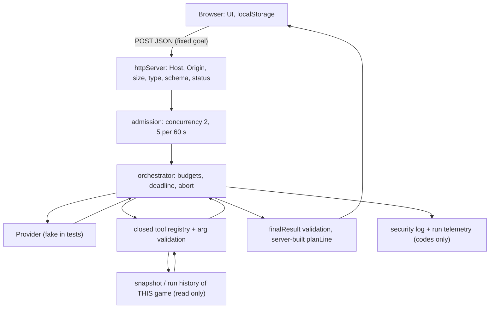

# EVIDENCE_W08 — Secure the Arcade

Game: RETRO SNAKE. Hardened flow: **W05 Shop Strategist** (`POST /api/games/:id/shop-agent`, paused perk shop). Spec: `specs/005-secure-arcade/`.

## 1. Scope and checkpoint

| | |
|---|---|
| Baseline commit | `05456e3` (branch `best-game-phase1`) |
| W08 branch / code commit | `week08-secure-arcade` / `415b289` |
| Environment | macOS, Node v24.20.0, Chromium (Playwright headless shell 153), fake provider only, no API key |
| Baseline results | `npm test` 175/175, `npm run build` OK, `npm audit --omit=dev` 0, `npm run test:e2e` 18/0/0 |
| Final results | see §6 |

Commands: `npm test` (typecheck + all unit/integration incl. `tests/security/`), `npm run build`, `npm run test:e2e` (W05 browser), `npm run test:security` (typecheck + security tests + build + `test:e2e:security`), `npm run security:scan`, `npm audit`.
Normal W05 flow before the change (baseline fixture): `get_shop_state` → `evaluate_perk_plan` → `final`, completed, state unchanged; the same flow is T00 and still passes.

## 2. Threat model



### Data crossing boundaries

| Field | Controlled by | Checked in | Used in | To model? | Stored? |
|---|---|---|---|---|---|
| Agent goal | browser | exact `{"goal":"plan_next_purchases"}` (`httpServer`) | selects the flow | fixed literal only | no |
| Game id (URL) | browser | existence in `GameSessionManager`; random UUID | resource handle, **not** a credential | no | in memory |
| Direction / perk | browser | exact-key schema + engine rules | game actions | no | server state |
| Game config | browser | `parseGameConfig` (clamps, fallback) | new game | no | server state |
| Score, XP, level, points | **server** | engine | HUD, tools | numbers via tool results | server state |
| localStorage records / settings / mute | browser | `parseRecords`, name → 3 chars `A-Z0-9` | local HUD only | never | browser only |
| Model decision / tool name / args | model | envelope, registry, `validateArgs` | tool dispatch | — | no |
| Tool result | server tools | `validateResult` (exact keys, ≤ 4 KiB) | next model call | yes (numbers, enums) | transcript in memory |
| Final result | model | `validateAgentResult` + evidence must match transcript | UI via `textContent` | — | no |
| Provider key | server env | never read by code that can reach client | `x-goog-api-key` header | never | no |
| Logs | server | closed field set | operators | no | stdout |

Not present: login/session/bearer tokens (no authentication; ids are identifiers, not access tokens), URL parameters, replay/import, free-text player input to the model.

### Risks

| # | Scenario | Precondition | Asset | P | Impact | Existing control | Planned proof |
|---|---|---|---|---|---|---|---|
| R1 | A foreign web page POSTs `text/plain` with no CORS preflight to `127.0.0.1:3001/api/games` (or a known game) and creates sessions or spends provider quota. | player has the game server running and visits the page | memory, provider cost | M | M | none (CORS was never needed, so nothing blocked "simple" requests) | T03, S6 |
| R2 | Repeated or parallel `shop-agent`/`shop-advice`/`coach` calls (also from many game ids) exhaust provider quota / CPU. | any client that can reach the port | cost, availability | H | H | only a per-game in-flight guard | T13, T17 |
| R3 | Model proposes `set_score`, `purchase_perk`, `constructor`, or another game's id. | provider returns hostile JSON | game state, privacy | M | H | closed registry, exact args, no mutation API reachable | T07–T09 |
| R4 | Model or tool output containing markup reaches the DOM and runs. | any change to a renderer (`innerHTML`) | player browser | L | H | `textContent` only | T04/T05, S3 |
| R5 | Production page served without CSP / nosniff; an injected script or third-party resource would run. | any future DOM sink | player browser | L | H | none (Vite dev only, no headers) | S1, S4 |
| R6 | Forged `localStorage` score/name is displayed as, or accepted as, a real result. | player edits storage | game integrity | H | L | `parseRecords` drops malformed data; score is never sent to server | T15, S5 |
| R7 | Server key or stack trace leaks through an adapter error, tool field, or log line; hostile text forges a log record. | upstream error echoes the key | secrets | L | H | key only in header; errors mapped to codes | T10, T14, S7 |

**Priorities:** R2 (resource exhaustion, nothing limited it), R1 (cross-site spend/session creation), R5 (no browser security profile for the production build).

## 3. Rules and limits

Invariants I1–I8, limits and the HTTP status policy are in `specs/005-secure-arcade/spec.md`. Where each lives:

| ID | Code | Tests |
|---|---|---|
| I1 | `server/httpServer.ts` (guards run before routing; admission after validation) | `http.test.ts`, `budget.test.ts` |
| I2 | exact-key bodies; `DEFAULT_LIMITS`/`SECURITY_LIMITS` constants | `http.test.ts` T02 |
| I3 | `server/agent/tools.ts` | `agentBoundary.test.ts` T07/T08 |
| I4 | tools read snapshots only | T00, T09 (spy on `purchasePerk/move/pause/resume/restart/advance/create` = 0 calls, state identical) |
| I5 | `textContent` in `src/main.ts`; CSP | `secureArcade.e2e.ts` S3, S4 |
| I6 | `server/agent/types.ts`, `server/security/admission.ts` | T11–T13, T17 |
| I7 | `server/security/securityLog.ts`, `googleTransport.ts` | `leakage.test.ts`, S7 |
| I8 | untouched W05 code path | T00 + 175 W05 tests + `test:e2e` |

## 4. Result matrix

`tests/security/` = `http.test.ts`, `agentBoundary.test.ts`, `budget.test.ts`, `leakage.test.ts`; browser = `scripts/e2e/secureArcade.e2e.ts` (S1–S7). All results below are from the final run (§6).

| ID | Applies | Fixture / input | Expected | Observed | Location |
|---|---|---|---|---|---|
| T00 | yes | paused shop, 3 pts, scripted `state → evaluate → final` | completed, ≥2 model steps, 1+ real tool, no mutation | pass | `agentBoundary` T00; browser S2 |
| T01 | yes | broken JSON, wrong type, wrong goal, null, array, `{}`, `text/plain` | 400/415, provider calls = 0; valid goal then runs (3 calls) | pass | `http` T01 |
| T02 | yes | 40 KB declared; chunked 20 KB without length; `maxSteps/ownerId/role/provider/model/maxToolCalls` one by one; body exactly 16 384 B | 413; 400 each, calls = 0; exact cap not 413 | pass | `http` T02 ×2 |
| T03 | yes (public/demo, no private resources) | unknown ids (`../`, `%00`, `constructor`, `__proto__`); two games; foreign Origin; foreign Host | 404/400, calls = 0; other game id never in model context; 403 | pass | `http` T03 ×2; browser S6 |
| T04 | yes | hostile `` / `<script>` in model summary + finding, via real UI | marker undefined, no child element in output, no injected `img`/inline `script`; Serbian letters, `'`, `a < b` render literally | pass | S2, S3 |
| T05 | yes (text-only UI, no Markdown/links) | `javascript:` URL text, raw HTML in message | shown as text; no `a[href^=javascript:]` | pass | S3 |
| T06 | yes | `kind:banana`, oversize summary, `completed:false`, extra envelope key, string, null, array, non-JSON reply | `stopped`, no result, 1 provider call | pass | `agentBoundary` T06 ×2 |
| T07 | yes | `constructor, toString, __proto__, hasOwnProperty, valueOf, set_score, purchase_perk`, case/space variants, non-strings | `unknown_tool`, 0 tool calls, 0 mutating calls, state identical | pass | `agentBoundary` T07 |
| T08 | yes | valid tool names with foreign `gameId`, `limit` 0/6/"3"/1.5, plan of 4, unknown perk; positive `limit:5` | `invalid_tool_arguments`, 0 executions; limit 5 executes; history returned = this game's | pass | `agentBoundary` T08 |
| T09 | yes | hostile provider: `set_score 999999`, `purchase_perk`, foreign `gameId`, "ignore the rules" final with an unevaluated plan | refused regardless of prompt; 0 tools, 0 mutations, state identical | pass | `agentBoundary` T09 |
| T10 | yes | tool adds `debugSecret: W08_SERVER_SECRET_DO_NOT_EXPOSE`; tool returns 10 KB | `tool_failed`, 1 model call only, sentinel not in model requests or outcome | pass | `agentBoundary` T10 |
| T11 | yes | repeated identical call; distinct calls until a limit; 30 transient failures with budget 4 | `repeated_action` (2 calls); ≤ 5 decisions; exactly 4 provider calls | pass | `agentBoundary` T11 ×2 |
| T12 | yes | fake clock 3×20 s with 30 s per-call/45 s total; provider ignoring abort answers late with a valid final | `deadline`, 3 calls, no 4th; late success never promoted | pass | `agentBoundary` T12 |
| T13 | yes | 4 parallel runs (cap 2); 6 sequential runs (rate 5/60 s, fake clock) | max 2 at provider, surplus 503 + `Retry-After` before provider; 6th = 429, provider calls stay 5; slots 0 afterwards; recovery after window/release; validation errors do not use budget | pass | `budget` ×3 |
| T14 | yes | key `W08_SERVER_SECRET…` in real Google adapter with fetch stub echoing it + stack; forged log record in tool name; rejected request logs | key only in `x-goog-api-key`; absent from response, model body, URL, telemetry, security log; no forged event; one JSON object per line; no body/path/game id | pass | `leakage` ×4 |
| T15 | yes | action bodies with `score/perkPoints/state`; localStorage with 999 999 999 score and `` name | 400, state byte-identical; UI shows safe text; agent request body is exactly `{"goal":"plan_next_purchases"}`; server score < 1000 | pass | `http` T15; S5 |
| T16 | yes | production build served by `start:prod` profile | active CSP (no Report-Only, no `unsafe-*` in script-src), nosniff, no-referrer; inline + external script blocked with `script-src-elem` violations while a no-CSP control page runs the same inline script; probe server received 0 requests; game + AI plan work with 0 CSP violations from the app; sentinel loaded by server (length 31) and absent from every file in `dist/` incl. names, from responses and logs | pass | S1, S2, S4, S7 |
| T17 | yes | browser disconnect mid-run with cap 1 → blocked 2nd run → disconnect → 3rd run | 503 while busy; provider call aborted (1); active 0; next run 200 | pass | `budget` T17 |
| CSRF | N/A for cookies (no cookie/credential is sent automatically). Covered anyway: cross-site simple POST | foreign-origin `no-cors` POST from a page on another port | refused by Origin check (`ORIGIN_NOT_ALLOWED` in log), 0 sessions created | pass | `http` T03, S6 |

## 5. Before / after

Same probe script run against the baseline worktree `05456e3` and the hardened branch (fake provider counting calls; not a real attack):

| Scenario | Before (`05456e3`) | After |
|---|---|---|
| Foreign `Origin` POST `/api/games` | **201**, 1 session created | **403**, 0 sessions |
| `text/plain` body to `/api/games` | **201** | **415** |
| 8 sequential agent runs, one process | `200 ×8`, provider called **8×** | `200 ×5, 429 ×3`, provider called **5×** |
| 40 KB body | 413 (already safe; regression test added) | 413 |
| Extra `maxSteps` in body | 400 (already safe; regression test added) | 400 |
| `X-Content-Type-Options` on API | absent | `nosniff` |
| Security headers / CSP on the built client | none (no production server existed) | CSP + nosniff + no-referrer, verified in browser |

Changes: `server/security/*` (new), `server/httpServer.ts` (guards before routing, admission around the three provider routes, headers, `x-correlation-id`), `server/index.ts` (`--serve-dist`, security log). Two W04 tests posted JSON as `text/plain` and now send `application/json`; no assertion was weakened.

### 5b. Second pass: review tools and misuse resistance

Run after the first green build, to challenge our own claims:

| Tool / method | Scope | Result |
|---|---|---|
| Security review of the branch diff (`/security-review`) | `server/`, `src/`, `scripts/`, `index.html` vs `main` | 0 findings over the confidence bar. Checked: static path traversal, Host/Origin parsing (userinfo, IPv6, `null`, case, ports), WebSocket origin, DOM sinks, key exposure, tool lookup by prototype names, command execution in scripts |
| Trail of Bits `insecure-defaults` audit | `server/` (134 files, 6 categories, 74 patterns) | 12 candidates, all refuted on evidence (e.g. `Math.random` only places food; session ids use `randomUUID`), 0 findings |
| Trail of Bits `sharp-edges` (manual, misuse of our own config API) | `server/security/*`, `createGameHttpServer` options, agent limits | **3 real footguns, fixed below** |
| Property-based test (optional challenge, §9 of the assignment) | tool dispatch | 300 seeded random proposal sequences (seed `20261027`, replay with `W08_SEED`); invariant holds; the generator reaches both sides (allowed calls executed and >100 runs refused) |

Sharp edges found and fixed (each has a test in `tests/security/sharpEdges.test.ts`):

| Footgun | Before | After |
|---|---|---|
| `{ ...DEFAULT_LIMITS, ...overrides }` lets `{ maxAgentSteps: undefined }` replace the default, and `NaN`/`Infinity`/`0` make `count >= limit` never true, so the limit silently disappears | silent | `resolveLimits` keeps the default for `undefined` and **throws** on anything but a positive integer or on an unknown key; used by admission control, `runAgent` and `createShopAgent` (startup) |
| `staticRoot` pointed at a project folder (`"."`) serves `.env` and `.git` | `GET /.env` → **200** with the file (test fails on the previous code) | dot segments are never served (`/.env`, `/.git/config`, `/%2eenv`, `/.%65nv` → 404) |
| `allowedOrigins: ["*"]` or `["null"]` looks like config but `"null"` admits sandboxed iframes and `file://` pages | accepted | constructor throws unless each entry is an exact http(s) origin |
| `createGameHttpServer` without `securityLog` dropped all events | no-op default | real JSON logger by default |

Allowed decisions and run completion are now logged too (`agent.run.finished` with `AGENT_RUN_COMPLETED`/`allowed` or `AGENT_RUN_STOPPED`/`stopped`), plus `INVALID_REQUEST` for schema rejections on the AI routes, as §F of the assignment asks.

## 6. Delivery checks (final run on branch `week08-secure-arcade`)

| Check | Result |
|---|---|
| `npm run typecheck` | clean |
| `npm test` | 204 tests, 204 pass, 0 fail (175 W05 + 29 W08) |
| `npm run build` | OK |
| `npm run test:e2e` (W05 browser) | 18 passed, 0 skipped, 0 failed |
| `npm run test:e2e:security` | 7 passed (S1–S7) |
| `npm run security:scan` | passed. Note: it treats any tracked file whose name contains "secret" as a secret file, so the leak test is named `leakage.test.ts` |
| Sentinel | loaded by server, 0 occurrences in `dist/`, responses, logs |
| `npm audit` (all) | before: **2 high** (dev only); after: **0** |
| `npm audit --omit=dev` | 0 before and after |

Dependency findings (before): `vite ≤ 6.4.3` — GHSA-9jrq-w75r-8gcw (cross-origin script execution via custom middleware), GHSA-rq7h-c2jc-7f22 (files outside `server.fs.allow`), three `launch-editor` advisories (Windows `%` escaping, editor CLI flag injection, `existsSync` bypass); `source-map-js 1.0.0–1.2.1` — GHSA-68fv-2mgg-jv7q (event-loop DoS via source-map offsets). Exposure: devDependencies only; the dev server listens on loopback during development, the production profile is our own Node server and does not include Vite. Decision: **fixed** with `npm update vite source-map-js` (no `--force`, within the declared `^6.0.5` range): vite 6.4.3 → 6.4.5, source-map-js 1.2.1 → 1.2.2; all checks above re-run afterwards. An empty audit is not evidence about game logic. `npm` also warns that 3 packages (esbuild ×2, fsevents) have install scripts without an `allowScripts` policy; not changed in W08 (open, see §7).

Redacted example events (real output):

```json
{"event":"agent.run.rejected","timestamp":"2026-10-27T10:38:34.763Z","correlationId":"w08-dc3e4c6d","reasonCode":"AGENT_RUN_REJECTED","outcome":"denied","stopReason":"unknown_tool","steps":1,"executedToolCalls":0}
{"event":"http.request.rejected","timestamp":"2026-10-27T10:38:34.766Z","correlationId":"w08-ada7133c","reasonCode":"UNSUPPORTED_MEDIA_TYPE","outcome":"denied","status":415}
```

Setup note for the browser suites: `npx playwright install chromium` once.

## 7. Limitations

- Rate and concurrency limits are in memory, one process, **global** (the demo has no identity). A real deployment needs per-identity limits and a shared store.
- No authentication: a game id is an unguessable UUID used as a handle, not a credential. Anyone holding it can act on that game. Read-only agent output still discloses that game's own state only.
- Origin check trusts the browser's `Origin` header; non-browser clients can omit it (they can also just call the API, which has no secrets to protect). In development any loopback origin is accepted because Vite proxies from another port; the production profile is same-origin only.
- `Host` allowlist is loopback only. The server binds to `127.0.0.1`; hosting elsewhere needs a configured hostname list.
- Fake provider tests prove **execution control**, not that a real model resists prompt injection. No free-form untrusted text reaches the model in this flow (tool results are numbers and enums), so the injection test is at the provider boundary.
- CSP `style-src 'self'` works because the app sets styles through CSSOM and has no `style=` attributes; a future inline style attribute would be blocked and show up in S2.
- Log "no secret" proof covers the sentinel on tested paths; it is not data-loss prevention.
- Local records/high scores remain unauthenticated client data (no leaderboard exists); they are displayed only to the same player and never sent to the server.
- HTTPS/HSTS not covered (local HTTP demo). `npm` install-script policy not configured.
- Not tested: Windows (macOS only, as in W04/W05), live provider, load beyond the small parallel probes.
- Next concrete test: per-identity rate limit once the game gets accounts; `npm install-scripts` allowlist plus a clean frozen install in CI.

## 8. Pair work and AI assistance

- **AI assistance (Claude Code, this session):** used the `security-and-hardening` skill for the threat model, then `/security-review`, Trail of Bits `insecure-defaults` and `sharp-edges` for the second pass (§5b). Inventoried the existing W05 boundaries, proposed the gap list (§2), wrote the `server/security/*` modules, the guards, the test suites and this document. All claims in §4–§6 come from commands run in this session (outputs above); the baseline comparison used a throwaway git worktree of `05456e3`.
- **Verification of AI output:** each rule has a negative test and a positive control; the CSP test checks that the same inline script runs without the policy; the baseline probe shows the two new refusals failed before the change.
- **Member contributions:** *to be completed by the pair.* Suggested split per the assignment: one member reviews/extends one protection and one negative test (e.g. Origin guard + `http.test.ts` T03; admission control + `budget.test.ts`), then swaps and tries to break the other's claims with a new variant (different resource id, extra JSON field, late response, two simultaneous requests). `specs/005-secure-arcade/tasks.md` T-11 stays open until done.
